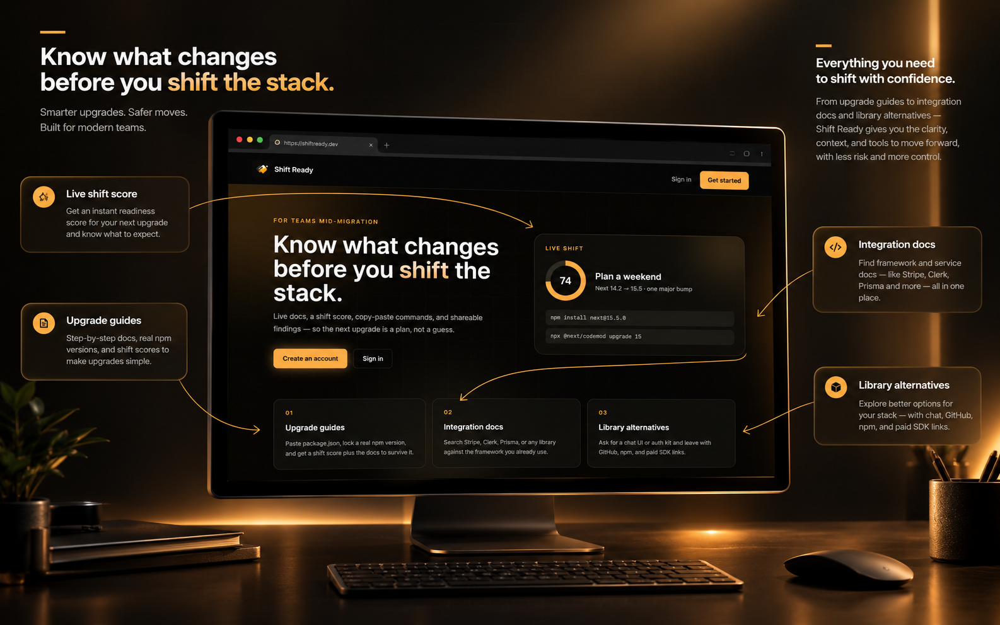
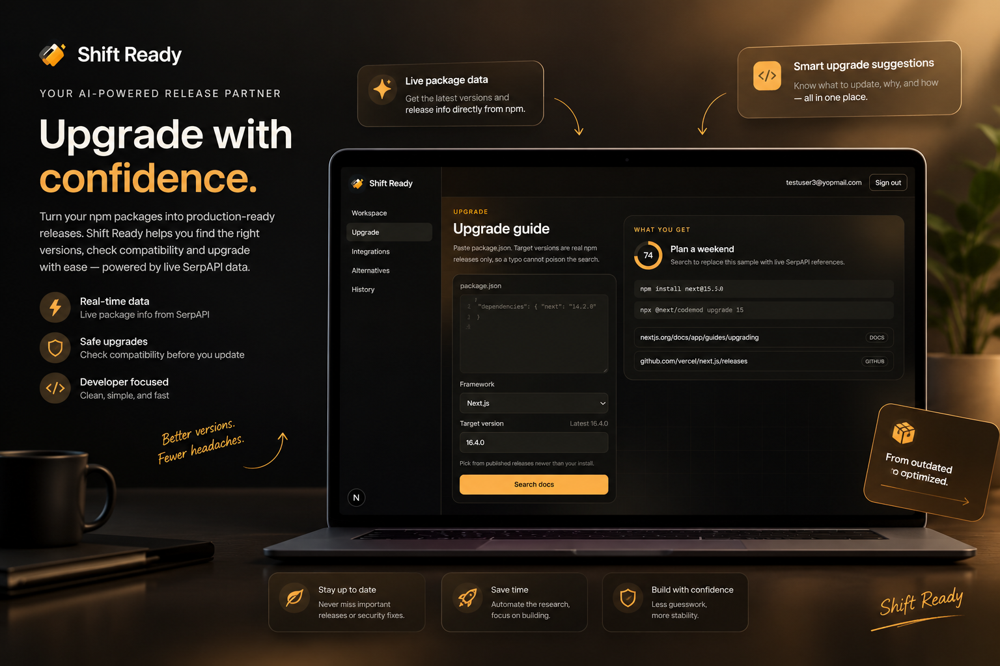
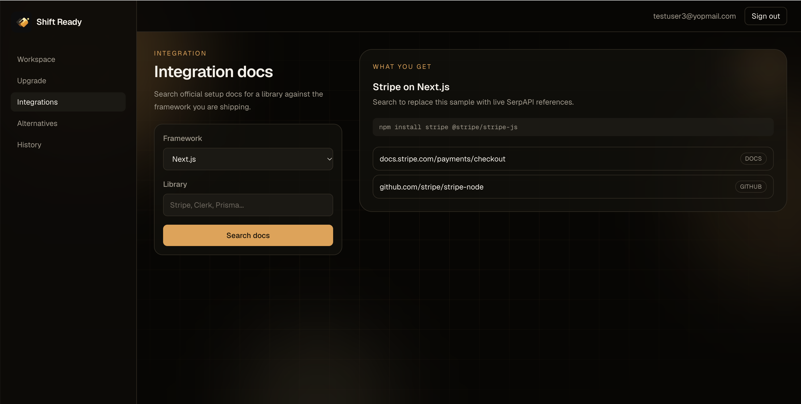
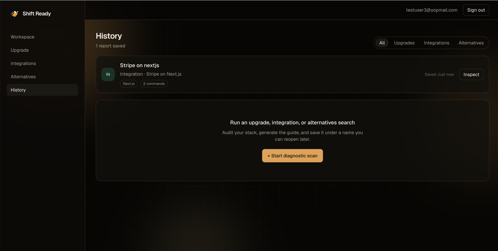
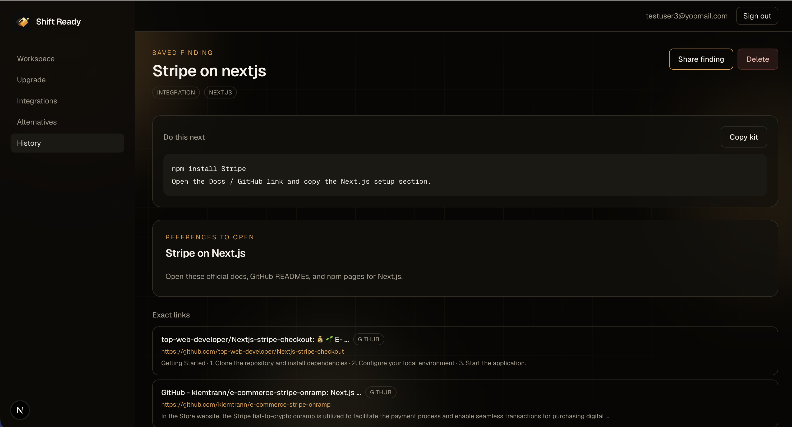
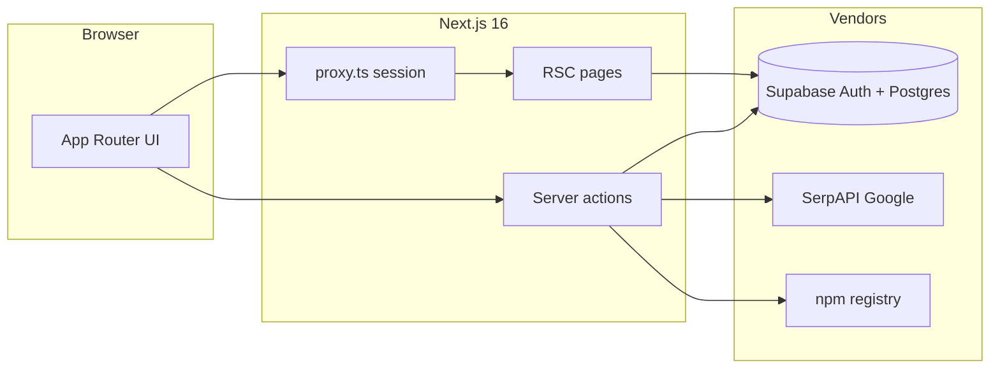

<p align="center">
  
</p>

<h1 align="center">Shift Ready</h1>

<p align="center">
  Know the blast radius before you shift the stack.<br />
  Upgrade guides, integration docs, and library alternatives — scored, sourced, and shareable.
</p>

<p align="center">
  
</p>

<p align="center"><sub>Add <code>docs/screenshots/hero.png</code></sub></p>

---

## What it is

Shift Ready is a signed-in workspace for mid-migration teams. Paste a `package.json` or name a library, search live documentation through SerpAPI, then save the finding under a name you can reopen or share.

| Tool | Input | Output |
| --- | --- | --- |
| **Upgrade** | `package.json` + published npm target | Shift score, install/codemod kit, GitHub / docs / npm links |
| **Integrations** | Framework + library (Stripe, Clerk, …) | Official setup references |
| **Alternatives** | Framework + need (chat UI, auth, …) | Ranked OSS vs paid options with exact URLs |
| **History** | Saved findings | Filterable reports, inspect, public share link |

---

## Product tour

Replace each path with your screenshot. Keep the filename; the README will pick it up.

### Workspace

<p align="center">
  
</p>

<p align="center"><sub><code>docs/screenshots/workspace.png</code></sub></p>

Signed-in home: left nav, top-right account, three shift cards, live score preview.

### Upgrade scan

<p align="center">
  
</p>

<p align="center"><sub><code>docs/screenshots/upgrade.png</code></sub></p>

Target versions are **published npm releases only**, and must be newer than the installed version.

### Integrations & alternatives

<p align="center">
  
</p>

<p align="center"><sub><code>docs/screenshots/integrations.png</code></sub></p>

<p align="center">
  
</p>

<p align="center"><sub><code>docs/screenshots/alternatives.png</code></sub></p>

Results prefer GitHub, npm, and official docs. Shopping and unrelated domains are dropped.

### History

<p align="center">
  
</p>

<p align="center"><sub><code>docs/screenshots/history.png</code></sub></p>

UP / IN / AL rows, type filters, relative time, **Inspect**.

### Share

<p align="center">
  
</p>

<p align="center"><sub><code>docs/screenshots/share.png</code></sub></p>

Public `/s/{share_id}` — no login required once a finding is published.

### Mobile

<p align="center">
  
</p>

<p align="center"><sub><code>docs/screenshots/mobile.png</code></sub></p>

Top bar + **Menu** drawer. Same routes as desktop.

---

## Navigation

### Public

| Route | Who | Purpose |
| --- | --- | --- |
| `/` | Anyone | Marketing landing |
| `/login` | Guests | Email / password sign in |
| `/signup` | Guests | Create an account |
| `/s/[shareId]` | Anyone | Read-only shared finding |

Signed-in users hitting `/login` or `/signup` are sent to `/dashboard`. Guests hitting app routes are sent to `/login?next=…`.

### App (auth required)

| Route | Nav label | Purpose |
| --- | --- | --- |
| `/dashboard` | Workspace | Pick a shift |
| `/upgrade` | Upgrade | Migration scan |
| `/integrations` | Integrations | Library setup docs |
| `/alternatives` | Alternatives | OSS vs paid |
| `/history` | History | Saved reports |
| `/history/[id]` | — | Inspect, share, delete |

Chrome: **sidebar** (logo + those five items) · **top bar** (email + Sign out).

### Keyboard

There are no global hotkeys. Use the sidebar, or:

- **Enter** in a tool form — run search
- **Tab** — move between fields
- Browser **Back** — return to Workspace / History

---

## System design



### Layers

| Layer | Role |
| --- | --- |
| **UI** | App Router, sidebar shell, tool forms, result views |
| **Proxy** | Refresh Supabase cookies; guard `/dashboard`, `/upgrade`, `/integrations`, `/alternatives`, `/history` |
| **Server actions** | Auth, search, save / publish / delete — SerpAPI key never reaches the browser |
| **npm registry** | Upgrade targets: `dist-tags.latest` + version list |
| **SerpAPI** | Two Google queries per search, then rank GitHub / npm / docs |
| **Supabase** | Email auth, `projects` table, RLS |

### Search pipeline

1. User submits a tool form (must be signed in).
2. **Upgrade only:** parse `package.json`, detect framework, reject invalid / older / unpublished versions.
3. Build 1–2 Google queries (docs host + GitHub/npm).
4. Fetch SerpAPI server-side.
5. Filter junk hosts, score sources, attach **shift score** + **command kit**.
6. Optional: save as a named project; optional: set `is_public` and copy `/s/{share_id}`.

### Shift score

Computed from current vs target semver (no extra API):

- Major jumps lower the score
- Labels: **Smooth shift** · **Plan a weekend** · **Treat as a rewrite**

### Data model

`public.projects`

| Column | Notes |
| --- | --- |
| `id` | Primary key |
| `user_id` | `auth.users`, cascade delete |
| `name` | User-facing title |
| `type` | `upgrade` \| `integration` \| `alternatives` |
| `framework` | e.g. `nextjs` |
| `query` | Queries actually sent |
| `input` | Form payload JSON |
| `result` | Score, commands, sources, alternatives |
| `sources` | Duplicate of result sources for listing |
| `is_public` | Shareable when true |
| `share_id` | Public slug |
| `created_at` | timestamptz |

RLS: owners can select / insert / update / delete. Anyone may **select** rows where `is_public = true`.

---

## Stack

- **Next.js 16** (App Router) · **React 19** · **Tailwind CSS 4**
- **Supabase** (`@supabase/ssr` + `@supabase/supabase-js`)
- **SerpAPI** (Google engine)
- **npm registry** (upgrade version lock)

---

## Setup

### 1. Supabase

1. Create a project and enable **Email** auth.
2. SQL editor: run [`supabase/schema.sql`](supabase/schema.sql).
3. If `projects` already existed without share columns, also run [`supabase/share.sql`](supabase/share.sql).

### 2. Environment

Copy `.env.example` to `.env.local`:

```bash
NEXT_PUBLIC_SUPABASE_URL=
NEXT_PUBLIC_SUPABASE_PUBLISHABLE_KEY=
SERPAPI_KEY=
```

`NEXT_PUBLIC_SUPABASE_ANON_KEY` is accepted as a fallback for the publishable key.

### 3. Run

```bash
npm install
npm run dev
```

Open [http://localhost:3000](http://localhost:3000).

```bash
npm run build
npm start
```

---

## Repo map

```text
app/
  page.tsx                 Landing
  login/ signup/           Auth
  (app)/                   Authenticated shell
    dashboard/             Workspace
    upgrade|integrations|alternatives/
    history/               List + [id] inspect
  s/[shareId]/             Public share
  actions/                 auth · search · projects
components/                Shell, tools, results
lib/
  serpapi.ts               Query + rank
  npm.ts · version.ts      Published versions
  kit.ts                   Score + commands
  supabase/                Browser, server, proxy
supabase/                  schema.sql · share.sql
docs/screenshots/          Drop PNGs here
```

---

## Demo script

1. Sign up / sign in.
2. Workspace → **Start an upgrade scan**.
3. Paste a `package.json` with `"next": "14.2.5"`. Confirm the target list is newer published versions. Try `99.0.0` — it should fail.
4. Search a real target. Show score, copy kit, docs links.
5. Save as `Shop Next 15`. History → Inspect → Share finding. Open `/s/…` in a private window.
6. Integrations: Next.js + `Stripe`.
7. Alternatives: Next.js + `chat` — GitHub/npm, not shopping results.

SerpAPI runs on the **server**. The browser only shows a POST to the page. Watch the terminal for `[serpapi] sending` / `received`.
